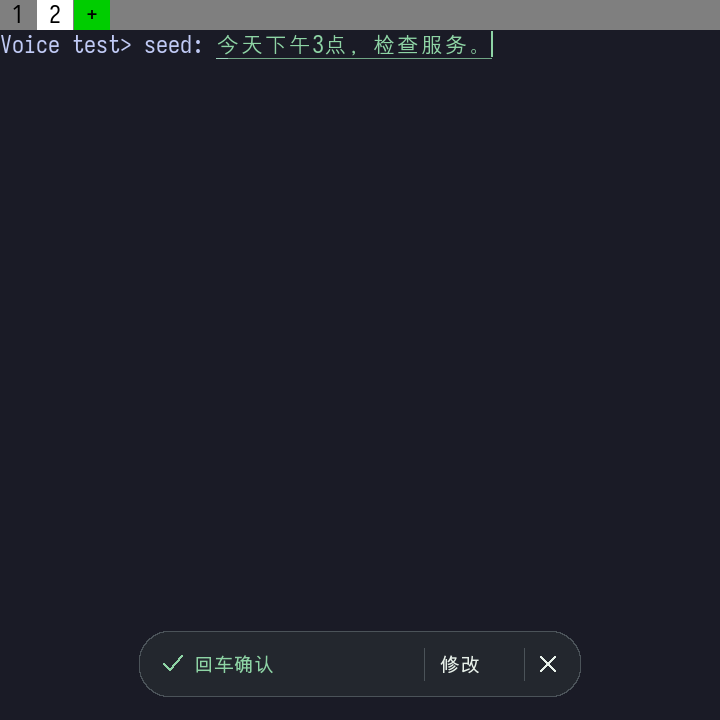
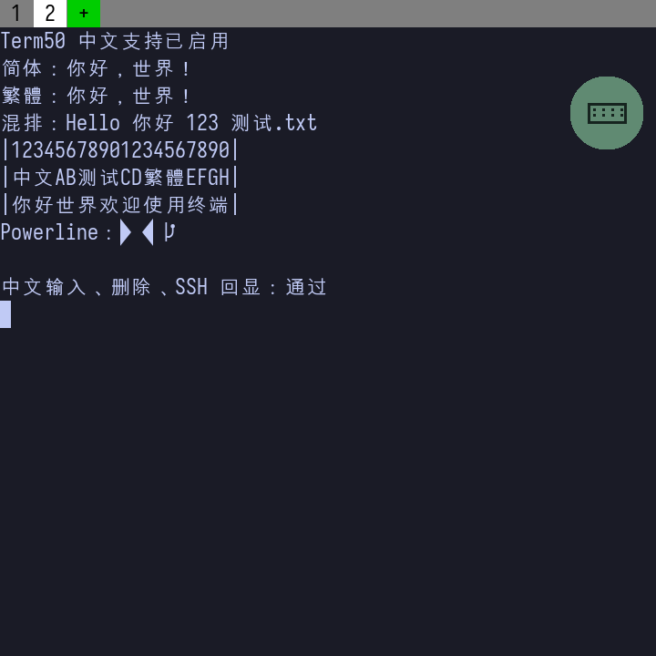

# Term50 · BlackBerry Q20 定制版

本仓库 fork 自 [acmiyaguchi/Term50](https://github.com/acmiyaguchi/Term50)，围绕 BlackBerry Classic（Q20）的实体键盘、中文终端、Shell 操作和语音输入继续开发。语音通过 Mac 上的豆包输入法完成识别；手机保留可编辑草稿，由用户决定何时插入终端。

[界面预览](#界面预览) · [定制功能](#定制功能) · [安装与使用](#安装与使用) · [语音配置](#语音配置) · [开发与文档](#开发与文档)

## 界面预览

| 原位语音草稿 | 中文终端 | Zsh 与历史建议 |
| :---: | :---: | :---: |
| <a href="docs/design/voice-inline-device-ready.png"></a> | <a href="docs/assets/chinese-q20.png"></a> | <a href="docs/assets/oh-my-zsh-q20.png"></a> |

三张图均为 Q20 运行画面。语音图中的文字是公开的模拟识别样例，不是手机到真实豆包识别的录像；[界面动效演示](docs/design/voice-inline-implementation.md)也使用测试文字与音量。

## 定制功能

- **原位语音输入**：长按 Q20 的 `0` 开始录音，识别快照在终端光标处显示。草稿可以改写、编辑或取消；确认后只插入原标签页，**不会自动执行命令**。手机与 Mac Companion 使用 TLS-PSK 通信。
- **实体键盘与浮动快捷入口**：按场景选择「终端操作」「Claude」或「tty 输入」。终端操作档提供方向、历史、粘贴和标签快捷键；也可在 `~/.term.lua` 中启用可选的 NORMAL/INSERT 模式。
- **中文显示**：终端正文按需回退到 BB10 系统中文字体，处理双列宽字符，保留所选主字体的英文排版。这里没有新增中文输入法。
- **Shell 扩展**：仓库包含 Zsh 历史列表和 Oh My Zsh 集成脚本。它们在已配置的 Q20 上有实机记录；新构建包是否带有相同 Shell 环境取决于打包所用资产，相关配置仍需按各自指南安装。

## 安装与使用

**这个分支目前提供源码与构建脚本，没有发布可直接安装的定制 BAR。**[上游发布包](https://github.com/acmiyaguchi/Term50/releases)不包含这里的语音与输入改动。

1. 获取本分支及其子模块：

   ```sh
   git clone --recursive --branch codex/term50-voice-integration https://github.com/b1ackm4x/Term50.git
   cd Term50
   ```

2. 按[构建指南](docs/building.md)准备 BerryCore/QNX 工具链、固定版本的 ARM OpenSSL 运行库，以及经哈希验证的基础 BAR，然后构建并打包。完整 BAR 需要仓库外的 bbnix、字体和 Fen 资产；打包脚本生成的是未签名 BAR，不会自动安装到手机。
3. 将 `dist/Term50-local.bar` 导入 [Sachesi](https://github.com/xsacha/Sachesi) 的应用安装界面，连接手机后执行安装，再打开 Term50。该产物是未签名原生 BAR，能否安装取决于设备状态；不要假定未经处理的原厂系统会接受它。若使用开发模式构建，可按[构建指南](docs/building.md#blackberry-ndk-and-nix-route)配置本地 `.env` 并使用 `make deploy`；该旧工具链路线尚未用当前语音代码重新验收。

打开终端后，右侧浮动按钮可切换操作档。默认仍可直接输入；选择「终端操作」后，`I/J/K/L` 分别为上/左/下/右，`R` 发送 Ctrl+R，`X` 发送 Ctrl+C，`V` 粘贴，`H` 切到前一标签，`N` 新建标签。可选的历史列表需要另行安装 [Zsh 历史脚本](docs/history-picker.md)；按键与模式的完整说明见[模式输入指南](docs/modal-input.md)和 [Lua 配置参考](share/term.lua.reference)。

## 语音配置

语音识别需要一台**已登录且未锁屏的 Mac**，其上已安装并登录豆包输入法，且已按外部 `doubao-stream-bridge` 项目的说明准备虚拟音频设备和 Python 环境。该桥接项目不在本仓库；必须先备齐它的 `.venv/bin/python` 和 `Doubao Stream Bridge` 虚拟设备，Companion 才能运行。Companion 不随手机 BAR 自动启动。先在 Mac 上从仓库根目录执行，替换示例目录和地址：

```sh
cd companion
export TERM50_DOUBAO_BRIDGE_DIR='/absolute/path/to/doubao-stream-bridge'
export TERM50_MAC_IP='<Mac 可达的 IP 地址>'
zsh build.sh
zsh run.sh --check
zsh run.sh --bind "$TERM50_MAC_IP"
```

首次真正启动后，Companion 会在 `companion/private/pairing.key` 创建私有配对密钥。在手机浮动按钮的「语音输入 → Mac 连接」中手动填写 Mac 地址、端口 `45850` 和该密钥，启用并保存；不要将密钥放入仓库或聊天。手机的「测试连接」只验证加密配对，不会启动豆包识别。

回到终端，**长按 `0` 约 0.6 秒**开始连接和录音，松手后继续录音；按回车结束，等待整理完成，再按回车确认插入。确认插入不会替你按下终端回车。按 Esc 可取消。Mac 需要保持解锁，识别期间接收窗口会占用前台。详细的权限、后台服务和故障排查见 [Mac Companion 指南](companion/README.md)与[手机语音指南](docs/voice-input.md)。

目前的验收覆盖 Q20 麦克风到模拟识别、草稿编辑和终端插入，以及公开测试音频到真实豆包的 Mac 链路；**手机麦克风到真实豆包的整条链路尚未完成验收**。具体证据见[语音开发验收记录](docs/voice-development-validation.md)。

## 开发与文档

初始化子模块后，可在主机上运行不依赖 BB10 设备的检查：

```sh
git submodule update --init --recursive
make test check-reference
make test-voice
```

主机测试使用模拟音频；依赖、BerryCore 构建和完整打包步骤见[构建指南](docs/building.md)。

| 想了解什么 | 从这里开始 |
| --- | --- |
| 语音操作与 Mac 配置 | [手机语音指南](docs/voice-input.md) · [Companion 指南](companion/README.md) |
| 语音界面与验证范围 | [原位界面实现](docs/design/voice-inline-implementation.md) · [开发验收记录](docs/voice-development-validation.md) |
| Q20 键盘与配置 | [模式输入](docs/modal-input.md) · [Lua 配置参考](share/term.lua.reference) |
| 中文与 Shell | [中文支持](docs/chinese-support.md) · [历史列表](docs/history-picker.md) · [Oh My Zsh](docs/oh-my-zsh-q20.md) |
| 构建与自动化 | [构建指南](docs/building.md) · [`termctl` / `term://`](share/AGENTS.md) |

本仓库沿用 [Apache 2.0 许可证](share/LICENSE)；第三方组件保留各自的许可文件。
