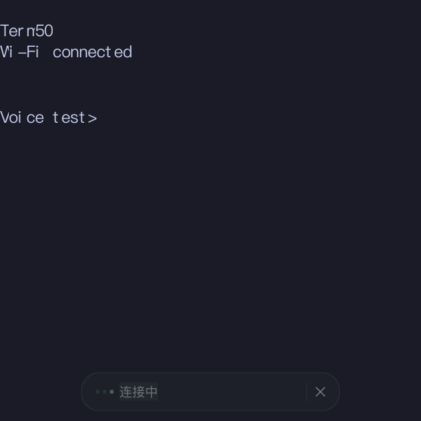
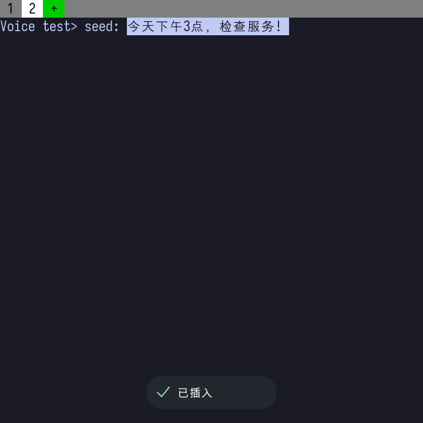

# Term50 轻量语音界面实现

日期：2026-09-26。目标：BlackBerry Q20，720×720。

沿用 [设计方案](voice-inline-v1.md)，默认录音入口使用底部 440×64 小组件，保留 24 像素边距和至少 48 像素取消触摸区域。宽度按实际中文字体、时长和操作按钮适配。终端不压暗、不切换整屏页面；修改长草稿、连接设置和错误详情仍可按需展开。

## 文字与动效

- 长按 0 约 600 ms 自动连接并录音，松手继续；回车停止，最终整理后再次回车仅插入，Esc 取消。
- 全文识别快照显示在真实终端光标位置，采用终端字号和中英文单元宽度，细下划线区分预编辑文字。最多显示三行，超长草稿跟随编辑光标滚动；小组件避让草稿。
- 文本随实际快照更新，允许缩短、撤回和整句改写。变化位置有约 160 ms 淡入，动画不会延迟文本更新，也不会把最终结果拆字播放。
- 胶囊约 200 ms 淡入并轻微上移；连接与整理圆点轮换；录音波形来自手机 S16LE 采样峰值，真实静音为零，停止、取消及错误时清零。
- 连接、录音与整理期间临时保持手机屏幕唤醒；结束、错误或取消后恢复原屏幕设置。主动锁屏或切换应用仍取消录音。
- 待确认时显示光标闪烁，可用实体键盘直接修改，点击「修改」展开完整编辑；已修改的草稿不被迟到快照覆盖。
- 确认插入后，小组件显示「已插入」约 1.2 秒再淡出，终端恢复正常输入。

动画目标为最多每秒十帧；来自识别快照的内容变化可独立触发及时重画。终端输入、会话绑定、全文修订、UTF-8 检查及确认提交继续由原模块负责，预编辑不写入 PTY。

## 绘制与录音

原生 Screen 渲染器在 UI 合成前保存终端底图。每个 Screen 缓冲记录终端底图版本和上次浮层区域；仅动画变化时恢复该缓冲此前覆盖的像素，跳过终端单元遍历与整屏复制；终端输出、光标变化、标签切换、布局或配置变化时重新生成底图，首次使用旧版本缓冲时完整刷新。每帧仅清除并合成草稿和小组件的实际非透明区域；重叠区域先合并，避免重复透明合成。中文字形与宽度采用有界缓存，字体或单元尺寸变化时失效；录音前预热中文 UI 字体。Wi-Fi 音频 TCP 连接启用 TCP_NODELAY，使每块音频及时发送。

第一次真机动画测试出现 `microphone_overrun`，已保留失败记录。优化针对实际绘制负担，没有忽略溢出或允许丢弃音频继续。

预编辑布局本轮验证普通中文宽字与英文文本；复杂组合字符和 emoji 连字尚未完整绘制，未作为本轮验收，不据此宣称支持完整 Unicode 字形组合。文本协议和编辑仍保留原 UTF-8 校验与字符边界。

## 演示

此 GIF 由生产 painter 在主机上绘制，使用公开示例文字和测试音量，不是豆包识别录像。实际真机验收、正式包摘要与安装状态见 [开发验收记录](../voice-development-validation.md)。

## 真机画面

画面来自 Q20 实际运行的小组件与隔离 zsh，文字为公开模拟识别样例；真实手机麦克风、Wi-Fi 传输、最终改写、编辑和终端提交已验收，不能据此宣称本轮完成真实豆包 ASR。
