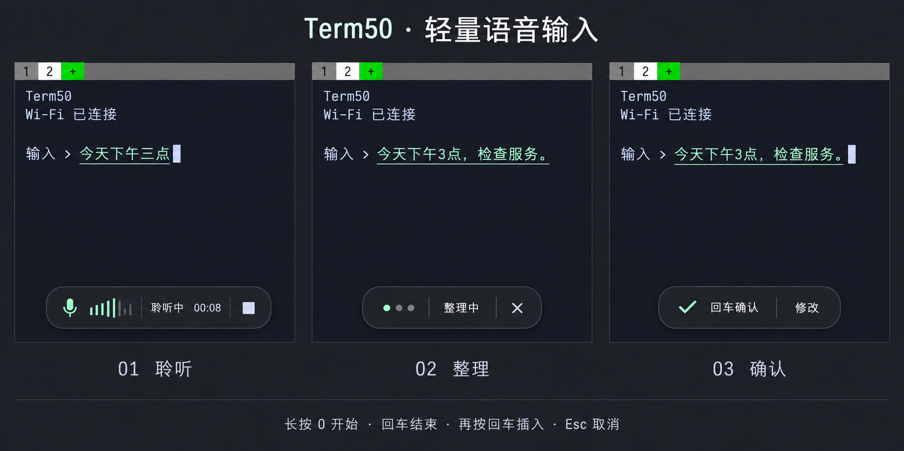

# Term50 原位语音输入概念 v1

日期：2026-09-26。目标为 Q20 手机 Term50 的 720×720 界面。
视觉与交互设计已落地到原生渲染器，交付记录见 [轻量界面实现](voice-inline-implementation.md)。本页的概念效果图由内置 imagegen 生成，原提示词完整保存于同目录。

## 布局

终端保持可见，不覆盖整屏、不压暗背景、不切换到独立听写页面。
标签栏、字体和终端配色沿用当前 Term50；文字在开始听写的输入位置显示。
底部居中放置约 320×64 的状态胶囊；具体宽度按字体与触摸尺寸适配，不能变成整宽面板。
胶囊与边缘保留约 24 像素间距，控件触摸区域至少 48×48。
当胶囊遮住当前输入位置时移至上方空闲区域；不覆盖标签栏。
连接地址、配对密钥与测试连接仅在按需打开的设置页出现。

## 状态与操作

| 状态 | 输入位置 | 小组件 |
| --- | --- | --- |
| 未使用 | 正常终端 | 隐藏 |
| 连接/准备 | 保留原输入 | 连接中 + 取消 |
| 聆听 | 实际识别快照在光标处更新；细下划线区分未确认文本 | 麦克风 + 波形 + 聆听中 + 时长 + 停止 |
| 整理 | 文本仍显示在原处，允许最终结果整句替换 | 动态圆点 + 整理中 + 取消 |
| 待确认 | 最终草稿可修改，光标与终端字号保持一致 | 回车确认 + 修改 |
| 已插入 | 恢复普通终端文本样式 | 短暂显示已插入，然后隐藏 |
| 错误 | 保留已有草稿 | 简短错误状态；点开可重试、复制或取消 |

沿用已交付的操作：长按 0 开始；松手继续；回车结束；整理完成后再按回车插入。
确认插入不发送终端回车，真正执行仍由用户决定。Esc 取消。
设置、错误详情和长文本完整编辑可按需展开，日常录音无需进入整屏页面。

## 流式文字

这里的“逐个出现”指文字随识别结果到达而更新，不人为把最终结果拆字播放。
识别可能一次返回多个字，也可能删除、缩短或改写已有文字。
新字可有轻微淡入，长句自然换行；不添加延迟来等待动画完成。
超出可用区域时显示最近 2–3 行并提供展开编辑入口。

录音与整理阶段采用输入位置的预编辑绘制层，草稿仍由现有语音状态拥有。
每次中间更新不写入 PTY：任意终端程序不具备可靠撤回已发送字符的能力。
确认时复用现有提交模块一次插入，保留 UTF-8、粘贴边界、短写处理和不执行命令的行为。
如果插入目标、标签或用户输入上下文失效，继续沿用当前取消/拒绝插入规则。
用户开始修改最终草稿后，迟到的识别快照不能覆盖修改。
波形必须来自真实采集音量；没有音量数据时只显示录音状态，不用假波形表示正在收到声音。

## 实现范围

可复用当前状态机、全文修订协议、草稿编辑、目标绑定、确认提交和异常恢复。
主要调整 `quick_ui` 的显示入口、`ui_painter` 的胶囊绘制，以及终端光标位置的预编辑布局。
将长按 0 的默认入口改为轻量组件；保留原设置页和完整草稿编辑作为按需入口。
整屏成功提示同步改成小组件中的短暂反馈。

验收重点为：终端保持可见、输入位置实时更新、中文换行与改写、胶囊避让、长文、断线草稿、取消、标签切换、修改后迟到更新，以及确认后未自动执行。

## 参考

- [macOS 听写](https://support.apple.com/en-au/guide/mac-help/mh40584/mac)：输入位置的状态反馈与听写。
- [Superwhisper 实时转写](https://superwhisper.com/docs/common-issues/realtime)：录音期间展示实际流式识别结果。

参考的是交互方式，视觉与终端行为按 Term50 设计。效果图中的文字、波形和状态均为静态设计示例，不是运行或真实识别证据。
