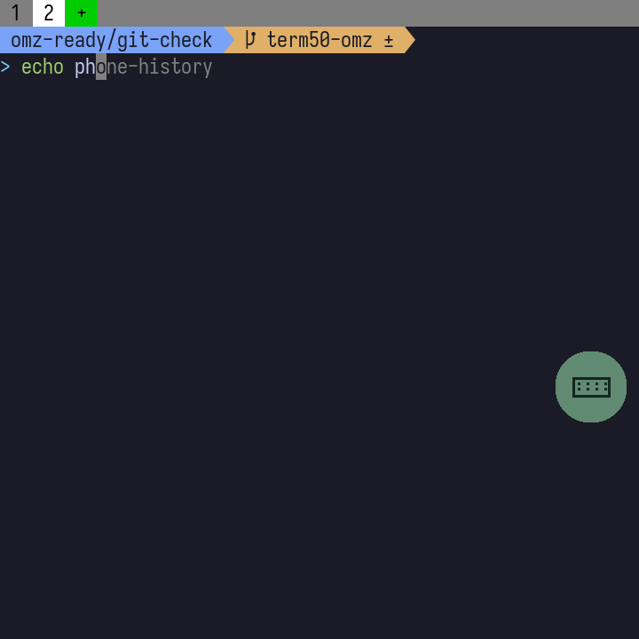

# Oh My Zsh on the Q20

Installed and verified on the real Q20 on 2026-09-20. The production app uses the new native Zsh and the saved Oh My Zsh configuration.

The subsequent [Chinese support update](chinese-support.md) adds terminal font fallback and builds Zsh with its upstream `--enable-unicode9` option for Chinese line editing on BB10's C locale. It preserves this Oh My Zsh configuration.

## Configuration

- Official Oh My Zsh, Agnoster theme, two-line prompt with the last two directory components.
- Tokyo Night palette through terminal OSC controls; `TERM=xterm-256color`, `COLORTERM=truecolor`.
- Official `git` plugin plus `zsh-autosuggestions` and `zsh-syntax-highlighting`.
- Existing Term50 history picker loaded after Oh My Zsh. Existing `mac` and `macvpn` wrappers retained.
- History stays in Term50's private data directory. Existing settings are backed up before the loader is appended to `.zshrc`.
- Automatic upstream updates disabled. The checked versions are pinned; the source repositories and their licenses remain included.
- Completion ownership and file-count checks run initially and daily, with the successful audit cached in private app storage. Oh My Zsh checks its revision and completion search path on every start. Remove `data/shell/omz-cache/compaudit-ok-5.9` to force another full audit immediately.
- Native Zsh bytecode caches reduce repeated parsing. Autosuggestion widgets bind once after all plugins and the history picker load.
- Agnoster's local adapter gets branch, staged, and unstaged status from one `git status --porcelain` call. It avoids the original theme's repeated Git processes on BB10; tracking divergence is not displayed.

## Native dependencies

Zsh 5.9 is rebuilt for ARM/QNX with statically linked `zsh/system` and `zsh/regex`. The normal ZLE and completion modules remain enabled. This build uses the existing bundled ncurses and BB10 compatibility libraries. The BerryCore SDK contains an OpenBLAS placeholder `sys/resource.h`, not a usable resource-limit implementation; `getrlimit`, `getrusage`, and the `rlimits` module are excluded. CPU accounting uses Zsh's `times()` fallback. No placeholder resource API is silently treated as working.

The real device also exposed an intermittent child-exit wait: the shell remained in `SIGSUSPEND` after the child finished, and delivering `SIGCHLD` released it. `shell/omz/patch-zsh-qnx.py` bounds that particular QNX kernel wait and checks child status on timeout. The check starts at 20 ms and backs off to 250 ms for long-running foreground jobs. Signal handling and job control remain enabled. This uses QNX's documented [TimerTimeout / SignalSuspend support](https://qnx.com/developers/docs/6.5.0SP1.update/com.qnx.doc.neutrino_lib_ref/t/timertimeout.html).

Git 2.55.0 is built from official source, with curl 8.22.0 and Mbed TLS 3.6.7 statically linked for HTTPS. The wrapper selects the bundled CA certificates and existing Term50 passwd compatibility library. Certificate verification remains enabled. Git's optional Perl, Python, GUI, SVN/HTTP-WebDAV, pthread, and Rust features are not part of this build. The intended supported workflow is local Git plus smart HTTPS and SSH.

The existing Iosevka Term font displays the Agnoster Powerline separators and branch symbol; a separate Nerd Font is not required for this theme.

## Verified checks

- Actual production default shell: Zsh 5.9, Agnoster, Git completion, autosuggestions, syntax highlighting, and the private history file.
- Existing terminal-profile keys: `R` opens history; `I` / `K` select; Enter inserts without executing; a second Enter executes; Alt+Sym cancels and restores the input.
- History suggestions, red highlighting for an unknown command, file-name completion, and `git checkout` completion.
- Twelve consecutive commands returned to the Git prompt. Sixty command substitutions and a background-job wait passed with the QNX wait workaround.
- Real Q20 rendering: 256 colors, both colon and semicolon truecolor escape forms, full RGB gradients, and Powerline characters. Readback pixel values were checked after converting the test adapter's BGRA byte order correctly.
- Native Git: initialize, create a branch, add, commit, clean status, and dirty diff.
- Native HTTPS: `ls-remote`, shallow clone of the official zsh-autosuggestions repository, and `git fsck`, with certificate checking enabled.
- Both existing `mac` and `macvpn` SSH connections, from the production main terminal: key authentication, remote command execution, and a real remote PTY. This verifies the current LAN/Tailscale routes, not an off-site network.
- The original `.zshrc` remains an exact prefix of the updated file. The history plugin and `.term.lua` are byte-for-byte unchanged.

With the prepared native caches, one fresh production app launch measured **1.69 s** for shell configuration and **2.14 s** to the editable prompt, timed from Zsh startup. Initial or daily full completion audits take longer. The general Agnoster collector was too slow on this device; the single-status-call adapter is part of the installed configuration.

The raw evidence lives in the local workspace's `q-term/omz-validation/` directory, outside this Term50 Git repository. Its `production-checks.txt`, `interactive-checks.txt`, `git-checks.txt`, and `git-clone-checks.txt` files are not included in the source checkout.

Cleanup is verified: the temporary startup hook, device test runner, validation token, staging files, and fixtures were removed. The formal app remains running with one terminal session and no native test interface. The Mac installation bridge and result collector were stopped, and their temporary tokens and test BAR were deleted. The raw cleanup record, `q-term/omz-validation/cleanup-checks.txt`, is local and not included in this Git repository.

## Installed files and backup

The app keeps Oh My Zsh in `data/oh-my-zsh`, native dependencies in `data/omz-runtime`, and the loader, plugins, and cache under `data/shell`. The backup directory is recorded in `data/shell/omz-backup-path`; it contains the original `.zshrc`, `.term.lua`, and history plugin. To revert the shell configuration, restore the backed-up `zshrc` to `$HOME/.zshrc` and start a new terminal session.

The BAR includes the installation payload at `native/term50-omz/payload.tar.gz`. The configuration on this Q20 has already been installed and backed up; subsequent app updates preserve it in app data.

## Source pins

| Component | Version / commit |
| --- | --- |
| Oh My Zsh | `157eb033f2a527021aac18c1f5850bbe3e3d223c` |
| zsh-autosuggestions | `85919cd1ffa7d2d5412f6d3fe437ebdbeeec4fc5` |
| zsh-syntax-highlighting | `0bfcb582e71d3abe604ce67bc0fe5a21f377507e` |
| Zsh | `5.9` |
| Git | `2.55.0`, `e9019fcafe0040228b8631c30f97ae1adb61bcdc` |
| curl | `8.22.0` |
| Mbed TLS | `3.6.7`, `068ff080b369adfac81509f9b57b2afabaf82dc5` |

Sources: [Oh My Zsh](https://github.com/ohmyzsh/ohmyzsh), [Agnoster](https://github.com/ohmyzsh/ohmyzsh/blob/master/themes/agnoster.zsh-theme), [autosuggestions](https://github.com/zsh-users/zsh-autosuggestions), [syntax highlighting](https://github.com/zsh-users/zsh-syntax-highlighting), [Zsh](https://www.zsh.org/), [Git](https://github.com/git/git), [curl](https://curl.se/), [Mbed TLS](https://github.com/Mbed-TLS/mbedtls).

The production BAR changes the bundled Zsh and includes a credential-free installation payload; its native terminal UI is byte-for-byte identical to the previously validated unified-history release. Installation of the shell configuration on this device is a separate backed-up step. The BAR does not include temporary test input handlers, validation tokens, or validation startup hooks.
