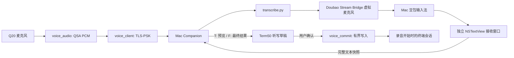

# Term50 豆包语音输入

Term50 在手机上采集麦克风音频，经加密连接发送到 Mac，再复用 Mac 上现有的豆包输入法识别。识别文本在终端输入位置显示为带下划线的预编辑草稿，底部小组件显示状态、音量和时长；用户检查、修改并确认后，才插入开始录音时的终端标签页。

当前实现支持真正的全文修订协议：中间文本可以增加、删除或整句改写，最终整理结果可以替换之前的文字。它不会把最终结果拆成单字来伪装流式识别。**2026-09-24 已通过真实豆包和加密传输验证录音期流式文字：首字 0.886 秒，录音结束前 46 次更新，停止后继续整理并得到完整结果。Q20 真机已验证麦克风采集、加密连接、模拟识别结果的预览、编辑和真实终端插入；手机麦克风到真实豆包的整条识别链路仍待 Mac 解锁后验收。**

## 使用

Mac 先按 [Companion 使用说明](../companion/README.md) 构建接收窗口并启动服务。默认端口为 `45850`；要让手机连接，需要把服务绑定到 Mac 可达的局域网或 Tailscale 地址。默认仅监听本机地址。

启动前可运行 `zsh companion/run.sh --check`：只读检查 Python、加密协议、接收窗口、虚拟音频格式与配对文件，既不录音也不切换系统设置。它不替代实际豆包识别或手机连接测试。

在 Term50 浮动按钮中打开「语音输入」，进入「Mac 连接」，填写 Mac 的 IP 地址、端口及私有配对密钥，再启用并保存连接。当前地址字段接受 IPv4/IPv6 字面地址，不解析主机名。

手机可保存 Mac 当前的 Wi-Fi 服务地址与端口，无需 USB。2026-09-26 已把 Mac 接收服务改为登录后启动、退出后自动重启；首次前台启动生成私有配对密钥后，用原桥接 Python 执行 `companion/service.py install --bind <Mac当前局域网地址> --bridge-dir <原桥接目录>` 安装，`status` 检查加密配对连接，`restart` 安全重启，`uninstall` 停止并取消登录启动。网络分配变化时需同步更新手机与服务，详见 [Wi-Fi 连接说明](../companion/README.md#wi-fi-连接与历史验收)。后台运行还需要 Mac 辅助功能授权，连接检查通过与真实识别通过分别验证。

「测试连接」只检查 TLS 配对与 Companion 协议连通性，不打开麦克风，也不启动豆包。显示「Mac 加密连接正常」不能证明豆包账号、辅助功能权限、虚拟麦克风或识别服务已经可用。

在终端页面直接**长按 `0` 约 0.6 秒**，会显示轻量语音组件并自动开始连接/录音；松手后继续录音。短按 `0` 在松手时按原键位处理，不需要先输入再退格。Alt/Ctrl/Shift、Meta、帮助页面、连接设置和草稿编辑中不抢占 `0`；原始 NORMAL/INSERT 短按规则保留。按住期间切换标签、输入上下文变化、触摸切换界面或应用离开前台会放弃此次长按，避免把延迟按键写入其他会话。

1. 从浮动按钮打开语音组件时点击「开始录音」；若通过长按 `0` 进入，则已自动开始连接。等待 Mac 接收窗口就绪并触发豆包录音快捷键。手机收到 `R` 后才打开麦克风；此信号不等于豆包服务端确认接收。
2. 录音时文字随 Mac 的实际识别快照出现在终端光标处，新字轻微淡入；底部波形反映手机采集音量。若豆包没有提供中间文字，草稿可以暂时为空。
3. 点击小组件中的「停止」或按回车，停止采集并等待豆包整理。整理时显示动态圆点，最终结果允许改写整句。
4. 完成后可直接使用实体键盘修改草稿，左右方向键移动光标，Backspace/Delete 删除完整 UTF-8 字符。「修改」按需展开完整草稿编辑页，也可在该页粘贴。
5. 点击「回车确认」或按回车，将草稿插入原标签页。小组件短暂显示「已插入」后消失。此处回车用于确认插入，不发送终端回车。真正执行命令仍需回到终端后自行确认。

小组件的 × 或 Esc 会取消本次识别。完整草稿页的返回操作先收起页面；Esc 仍取消。切换终端标签、关闭原标签或让 Term50 离开前台，也会停止该会话。已确认的文字正在插入时，页面会暂时阻止返回和切换，直到写入结束。每次新录音从空草稿开始，不续传前一次音频。

手机在连接、录音和整理期间临时保持屏幕唤醒，结束或取消后恢复原屏幕设置；主动锁屏或切换应用仍停止会话。

Mac 必须处于已登录、未锁屏的图形桌面。识别期间接收窗口需要占用前台；切换到其他 Mac 应用会取消。不要在该接收窗口中手动输入。此方式仍依赖豆包输入法自身的网络、账号与界面行为，不是独立的无界面语音 API。

## 模块与数据流



| 模块 | 职责 |
|---|---|
| `src/voice_shortcut.c` / `src/main.c` | 600 ms 长按 0 自动录音；短按重放原键位、输入顺序和上下文隔离 |
| `src/voice_audio.c` | QNX 音频管理器和 QSA 采集，检查实际格式、驱动分片、录音溢出与设备抢占；释放麦克风时清理缓冲区 |
| `src/voice_client.c` | 后台工作线程维护一条 TLS 连接，发送音频，检查帧长度、UTF-8、终端控制字符和递增修订号 |
| `src/quick_ui.c` / `src/ui_painter.c` / `src/ui_voice_painter.inc` | 小组件、真实音量波形、原位草稿、淡入与整理动效；中文换行、三行滚动、完整编辑入口；本地修改不被迟到快照覆盖 |
| `src/renderer_screen.c` / `src/main.c` | 缓存 UI 下的终端背景，动画恢复背景后只合成小组件和草稿区域；终端输出、光标或布局变化时重新绘制 |
| `src/voice_commit.c` / `src/main.c` | 绑定原会话，检查录音后是否有其他终端输入，独占并完成一次插入，处理部分写入与写入中断 |
| `companion/server.py` | TLS-PSK、单会话占用、协议状态、子进程生命周期、背压和超时 |
| `companion/transcribe.py` | 复用原桥接的 Python 音频环境，使用自有麦克风选择工具，持续播放 PCM，同时读取真正的文字变化 |
| `companion/MicRoute.swift` / `MicRouteController.swift` | 有界等待豆包设置与设备列表就绪，每个路由修改仅点击一次，再确认已选麦克风 |
| `companion/Receiver.swift` | 独立接收窗口，捕获组字/提交/撤销组字及定时快照，选择和恢复输入法，维持录音快捷键与心跳租约 |

原 `doubao-stream-bridge` 的源码、配置、运行日志和备份均不复制或改写。Companion 在原会话锁存在时与其协作，避免同时操作同一输入法。

## 状态与文本所有权

| 状态 | 允许操作 | 退出条件 |
|---|---|---|
| `IDLE` | 配置、开始录音 | 用户开始 |
| `CONNECTING` | 取消 | 接收窗口就绪且触发录音后开始采集，或连接/权限错误 |
| `RECORDING` | 查看动态预览、结束录音、取消 | 收到用户停止、120 秒上限、音频/网络异常 |
| `FINALIZING` | 查看更新、取消 | 停止后的稳定文字，或整理超时/恢复失败 |
| `READY` | 手动修改、粘贴草稿、确认插入、重新录音、取消 | 用户确认或取消 |
| `INSERTING` | 等待已开始的插入完成 | 完整写入，或目标关闭/写入超时 |
| `ERROR` | 查看或复制保留的草稿、重试或取消 | 新录音或退出 |

服务器发送的是完整快照，不是追加字符。每次 `T` 和 `F` 都携带严格递增的修订号；乱序、重复号、非法文本、停止前出现 `F` 都会中断该会话。断线后不重放音频，也不把不确定的最终文本自动插入。

最终状态仍使用界面层判断：停止后文字非空、没有组字标记、连续 4 秒稳定。它不是豆包服务端正式的完成事件。麦克风路由、输入法和前台应用恢复完成后，适配器才输出 `final`；服务端还要确认适配器输出结束且退出码为零，才向手机发送 `F`。恢复失败、额外事件或异常退出只返回错误。

手动编辑仅在 `READY` 开放。编辑后草稿归用户所有，迟到的服务端快照不能覆盖它。开始下一次录音会清空旧修订号和草稿。

进入连接设置再返回、或单独测试连接，不改变已有草稿最初绑定的标签与输入版本。目标标签退出或被删除后，草稿仍可复制；插入失败会退出等待状态并保留文字。触摸按钮按下时尚未可用，即使抬手前识别完成，也不会意外确认插入。

## 插入终端的边界

草稿没有经过普通动作字符串解析，也不会逐字退格修改已经发给 shell 的内容。确认时重新检查原标签是否存在、是否仍是活动标签，以及录音之后是否发生其他终端输入。输入发生变化时拒绝自动插入并复制草稿，避免替用户猜测插入位置。

只有 UTF-8 终端接受此输入。草稿中的换行和 TAB 在插入时转为空格，防止识别结果无意提交命令或触发补全；不附加回车。目标启用 bracketed paste 时带上相应边界。对任意正在读取输入的终端应用，文字仍会按该应用自己的输入规则处理。

写入支持短写和 `EINTR` / `EAGAIN`，并在插入期间排除其他输入交错。自动终端查询回复单独排队，不被误算为用户编辑。发生部分写入后不会重放整段文字：保留独立提交副本并复制到剪贴板，先补齐可能拆开的 UTF-8 字符及粘贴结束标记，再排空自动回复；界面提示用户检查当前输入。插入等待最多约 10 秒。

## 错误、取消与资源恢复

| 情况 | 行为 |
|---|---|
| 配对密钥错误、TLS 不匹配 | 认证失败；手机不打开麦克风 |
| 连接测试成功但豆包不可用 | 输入源、权限或虚拟麦克风问题在准备阶段返回；账号或识别服务异常可能直到无文字/整理超时才被发现，不能仅凭 `R` 判断识别服务健康 |
| Companion 已被占用 | 返回 `BUSY`，不启动第二场识别 |
| Mac 锁屏或豆包设置页面未就绪 | 准备阶段失败，不打开手机麦克风；提示解锁 Mac 并打开豆包语音输入设置后重试 |
| QSA 溢出、抢占或格式不支持 | 终止当前采集，不悄悄丢弃语音继续运行 |
| 网络慢、管道阻塞 | 有界缓存与显式超时；不丢帧冒充完整输入 |
| 连接断开、用户取消 | 释放手机麦克风，Mac 子进程取消识别并恢复输入法与麦克风 |
| Mac 接收窗口关闭、前台转到其他应用 | 取消识别；恢复用户刚选择的应用 |
| 适配器崩溃或失去响应 | Receiver 心跳租约失效后先释放 Option、取消识别，限时恢复原麦克风，再恢复输入法与前台应用，并清理自身私有临时目录；继承的会话锁覆盖整个恢复过程 |
| 服务关闭时正在取消 | 清理任务防止被重复取消打断；待恢复完成才释放独占会话 |
| 麦克风恢复失败/超时、输入法恢复失败 | `MICROPHONE_RESTORE_FAILED` / `MICROPHONE_RESTORE_TIMEOUT` / `INPUT_SOURCE_RESTORE_FAILED`；需检查对应设置，不返回成功恢复确认或最终结果 |

启动等待约 30 秒，最长录音 120 秒，手机停止后最多等待 45 秒。Mac ASR 默认等待最多 25 秒、稳定窗口 4 秒；清理另外有界等待。错误码属于协议诊断，UI 以简短状态文字提示。

录音和整理使用固定截止时间，持续收到中间文本也不能延长；不完整网络帧最多等待 5 秒。收到最终帧后会话即结束，同一网络读取中后续到达的预览或错误不会覆盖已接受的最终文字。停止或取消发生在麦克风打开期间时，不再读取采样。

## 隐私与配置

传输仅允许 TLS 1.2 的 `PSK-AES256-GCM-SHA384`，身份为 `term50`，使用 32 字节随机密钥，不回退明文。BB10 旧系统加密库不支持该密码套件，因此程序使用现有 bbnix OpenSSL 3.5.4 的固定哈希运行库与匹配 ARM 头文件，打包到 `native/lib`。Mac 密钥位于 `companion/private/pairing.key`，权限 `0600`；手机地址、端口与密钥保存于应用私有 `ui-settings.conf` 的同一原子事务，权限 `0600`，不写入共享 Documents 或普通日志。

音频只在有界内存和进程管道中流转，不保存录音文件。Receiver 的转写事件放在每会话私有临时目录，正常结束及租约失效后清理。租约恢复另写权限为 `0600` 的 `companion/private/last-recovery.json`，仅含时间、会话标识与错误码，不含文字、音频、麦克风名称或密钥。极端情况下整组进程被系统同时强杀，软件无法继续恢复麦克风和输入法，临时目录也可能由系统保留，不能视为安全擦除保证。测试客户端仅在显式指定 `--events` 时保存文字证据，默认不打印识别正文。

豆包输入法可能将音频发送到其识别服务；本模块不读取或导出豆包凭证，不声称离线识别。

## 验证记录与复验

主机测试数字更新于 2026-10-23；真实豆包及 Q20 的实验结果保留其 2026-09-24～26 原日期。下表分别列出模拟测试和真实豆包证据；Mac 识别成功不能替代 Q20 真机录音与插入验证。

异常路径修复、重新打包和各次真实识别结果见 [开发验收记录](voice-development-validation.md)。其中一次历史复验首段文字 1.010 秒，51 次中间更新中 47 次发生在音频结束前，17.495 秒得到与公开测试句一致的最终文字，原麦克风读回正常。

| 层次 | 用例 / 入口 | 验证证据 |
|---|---|---|
| Companion 协议、适配器与启动检查 | `companion/tests/` | 49 项通过；包含路由错误码透传、真实 TLS-PSK 握手、错误密钥、TCP 分片、最终改写、停止后取消/断线、持续预览下的硬超时、恢复失败不发最终结果、接收器异常退出、同批文本往返修订的稳定计时、进程和锁清理；另含严格密钥校验及只读启动检查；无真实 ASR |
| Native C ↔ TLS 服务 | `tests/test_voice_protocol.py` | 27 项通过；另有 1555 个 native 单元断言通过，启用 ASan/UBSan；覆盖就绪前不采集、打开麦克风期间停止/取消、并发启动、畸形/不完整协议、最终帧后数据隔离、背压取消和真正 Companion 子进程契约；麦克风由测试替身提供 |
| QNX 音频封装 | `tests/test_voice_audio.c` | 驱动替身测试通过：分片、would-block、溢出、抢占、格式检查及关闭资源；另已通过 Q20 真实麦克风采集与关闭后重开测试；模拟识别不代表真实 ASR |
| 草稿交互 | `tests/test_quick_ui.c` | 564 项检查通过，含 UTF-8 编辑、迟到修订保护、按钮触摸时序、错误草稿复制、插入期间页面保护 |
| 主界面与终端插入协调 | `tests/test_voice_ui_integration.py` | 868 项 ASan/UBSan 检查通过；直接编译生产协调函数，链接真实 UI/会话/提交模块，验证连接测试后的原目标保护、输入变化拒绝插入、标签退出/删除、短写/暂忙/中断、硬错误和超时恢复；PTY 与客户端由替身提供 |
| 草稿绘制 | `tests/test_voice_painter.c` | 中文换行、滚动、光标与尺寸变化测试通过，已检查本地渲染预览 |
| 终端输出顺序 | `tests/test_session_output.c` | 自动回复排队、独占插入、输入变化计数、满队列和中止恢复顺序通过 ASan/UBSan |
| 原功能回归 | `make test check-reference` | 12 项按键匹配、726 项模式输入、4 次控制客户端往返及配置版本检查通过 |
| Mac Receiver | `companion/build.sh` | Swift 构建及本机签名通过 |
| 麦克风切换时序 | `companion/tests/mic-route/main.swift` | 冷启动页面、已运行但窗口关闭后的单次重开、窗口状态未知、延迟设备列表、别名、选择未提交、动作不重复的纯状态测试通过 |
| 独立恢复逻辑 | `companion/tests/recovery/main.swift` | 假辅助进程的成功、失败、启动错误、超时强制退出，以及 `0600` 状态记录通过；没有操作真实系统路由 |
| 实际豆包识别、麦克风恢复和录音期 partial | 公开 PCM → 实际豆包 → 真实文本事件 | **已通过**；10.593 秒公开 PCM 经真实 TLS-PSK → 豆包，51 次中间更新（46 次在音频结束前），首字 0.886 秒，最终结果 18.138 秒，与测试句完全一致；4 次非追加修订，直接适配器测试 0 次音频欠载；结束后读回原麦克风，输入法恢复成功 |
| 实际取消与恢复 | 使用同一公开 PCM，2 秒后发送取消 | 收到 7 次真实中间更新后取消，返回 `CANCELLED`；2.059 秒内完成清理并关闭连接，麦克风恢复为原选项 |
| Q20 真机麦克风与终端完整闭环 | 手机说话 → 预览/整理 → 编辑 → 插入 | **部分通过**；Q20 实际麦克风 → TLS → 模拟识别 → 最终改写 → 中文编辑 → 真实 PTY 插入已通过，取消后重录已通过。真实豆包准备阶段因 Mac 锁屏停止，未播放公开测试音频；手机到真实豆包的完整识别仍待验收 |

在仓库根目录运行，不触碰真实音频设备的检查：

```sh
export TERM50_BRIDGE_PYTHON=/absolute/path/to/doubao-stream-bridge/.venv/bin/python
"$TERM50_BRIDGE_PYTHON" -W error::ResourceWarning -m unittest discover -s companion/tests -v
"$TERM50_BRIDGE_PYTHON" tests/test_voice_protocol.py
make test
make test-voice
```

BerryCore 原生构建使用 `tools/build-berrycore.sh`，它验证匹配的 OpenSSL 3 头文件与运行库。`python3 tools/package-voice.py --output dist/Term50-voice-inline.bar` 从原已验证 CJK/Oh My Zsh 包生成独立的 `dist/Term50-voice-inline.bar`，保留原包以便回退，校验全部资产摘要及其余资产逐字节不变。

历史真实 Mac 验证结果位于本机工作区 `q-term/voice-validation/live-mac-result.json`，逐次时间证据为 `live-tls-events.jsonl`；这份本机证据不纳入源码仓库。那次授权的公开合成测试输入 SHA-256 为 `e9dbeb169e8ae5bcd2f7d66943f7b962b7313684b0472148e3466aad8dfd7c4d`。`companion/verify-public-audio.command` 可对开发者自备的公开原始 PCM 与指定 SHA-256 复验，不录制实体麦克风。首次启动曾遇到豆包设置页面尚未就绪导致的路由失败，已单独修复启动等待逻辑。

真正识别验证需让 Mac 接收窗口独占前台，使用公开测试音频，并同时保留输入文件摘要、每次快照时间、音频结束时间、最终文字以及恢复检查。`companion/client.py --pcm ... --events ...` 提供该证据出口。只有音频结束之前出现非空 `T`，才能确认此次实际具备录音期文字流出；只有完成停止后的重写测试，才能确认最终整理替换行为。完整帧定义和服务命令见 [Companion README](../companion/README.md)。
